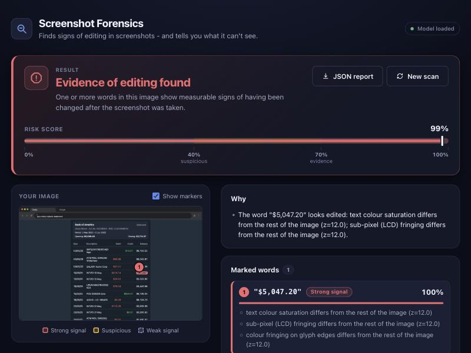

# Fake Screenshot Detector

**Checks what a screenshot says and how it was made, tells you how much independent evidence supports it, and never
says an image is genuine.**

> **Read this first.** Earlier versions tried to *detect edited pixels* and, measured on real edits, did not work: a
> detector trained on simulated edits found 2 of 9 edits made by a person with real tools, and flagged 3 of 23 genuine
> screenshots. A careful edit in the matching font leaves nothing in the pixels to find, and a screenshot rendered with
> false content from the start (browser developer tools, fake-receipt sites, AI images) has no edit at all. Version 3
> is built around that fact: every check must be **calibrated on genuine real screenshots before it may influence a
> verdict**, every check may answer **"I could not examine this"**, and any doubt moves the answer towards
> **"inconclusive, verify with the issuer"**, never towards "looks fine".

## What it does

1. **Capture profile.** Format, size, JPEG quality, lossless or not: how much pixel evidence can still exist.
2. **Type routing.** Identifies the kind of screenshot (payment receipt, bank statement, order or invoice, chat,
   social post, SMS/e-mail/notification, web page) with two independent routers: one reads the words, one looks
   only at layout. A router influences the result only after it was validated on real screenshots.
3. **Checks**, each returning *found something / found nothing / could not examine*:
   file metadata (editor tags), content consistency (dates and weekdays, totals, checksums, generator markers),
   number-column spacing, a word-rendering model (**advisory only**: it is not accurate enough on real data), and
   type-specific checks (UPI reference format, running balance, order arithmetic, chat time order, OTP format).
4. **Gates.** `model_data/gates.json` says which checks are *live* (measured on at least 20 genuine real screenshots
   with a false-alarm upper bound of at most 15%) and which are *advisory* (shown, never counted).
5. **Verdict policy.** `inconsistency found` and `possible inconsistency` come only from live checks. `No
   inconsistency found` needs a live content check **and** a live visual check to have examined the screenshot, and
   the type to be known. Everything else is `inconclusive`, with the reasons and a list of what to verify with the
   issuer. An uncalibrated signal can only make the answer more cautious.
6. **Compare mode.** If you hold a genuine copy, upload both and every difference is marked. It needs no model and
   also finds edits typed in the original font.
7. **You choose the type.** Pick the kind of screenshot (payment receipt, bank statement, order, chat, ...) and the checks
   written for it run; "not sure" falls back to automatic detection.
8. **Reconcile mode (a second source).** A forged screenshot can agree with itself but cannot change another record. Paste
   the receiver's bank SMS or a statement line (or upload a screenshot of it): every reference, amount, date and time in it
   is looked up in the screenshot. The screenshot's text is read twice, and a mismatch is a *conflict* only when both reads
   agree on a different value; a reference that differs by one digit is flagged for a look by eye and never counts as
   agreement.
9. **Assurance levels instead of "genuine".** Level 0 unverified (or a contradiction / conflict was found), level 1 no
   contradiction found (still unverified), level 2 consistent with an independent source, level 3 confirmed by signed
   data (not available yet). Nothing is ever called genuine.
10. **Version-1 cues as hints.** Error-level analysis, JPEG ghost, noise, copy-move and quantisation tables are shown as hints
    and can never count toward a verdict. Measured on the 23 genuine screenshots, ELA flagged 15 of 15 (applicable ones)
    and noise 23 of 23, so those two are labelled *not informative*.



## Where it stands (measured on real screenshots, 2026-10)

Real set: 23 genuine screenshots in six categories and 9 edited screenshots with their originals.

| | Result |
|---|---|
| Verdicts on the 23 genuine screenshots | 23 inconclusive, 0 flagged |
| Verdicts on the 9 edited screenshots | 9 inconclusive, 0 flagged (nothing live can see these edits) |
| Compare mode on the 9 edit pairs | **9 of 9** differences found; changed digits, amounts and names listed |
| Compare mode on harmless re-saves (JPEG q80, q60, down-scale 0.75) | 3 of 27 wrongly flagged (small areas, heavy JPEG on large images) |
| Content router on real screenshots | 18 of 23 answered, 18 of 18 correct (interval 82% to 100%) |
| Structure router trained on generated screenshots | 17% correct on real screenshots: **not used** |
| Word-rendering model | 3 of 23 genuine flagged (upper bound 32%): **advisory** |
| Reconcile mode, mutation test on the real screenshots (17 with facts) | faithful second source: 17 of 17 corroborated, 0 false conflicts; one fact changed (digit, amount or date): 17 of 17 noticed (4 amount and 8 date conflicts, 4 one-digit reference reviews, 1 amount change left at partial) |
| Pixel model trained on real edits (STFD, 3,932 tampered screenshots, split by source) | word-level AUC 0.81 on held-out STFD words (0.56 for the model trained on generated edits); after chat-app re-compression 0.73; on genuine Rico app screens it flagged 40 to 80% of images, so it is **not used** |

So today the pipeline can *flag a contradiction* (a date whose weekday is wrong, a generator watermark, an editor
tag) and otherwise says "inconclusive, verify". Compare mode is the strong tool when an original exists. Making the
visual and type-specific checks live needs more genuine real screenshots: see
[`docs/SCREENSHOTS_NEEDED.md`](docs/SCREENSHOTS_NEEDED.md).

## Run

```bash
# backend (port 5000 is taken by AirPlay on many Macs, so use 5051)
cd backend && python3 -m venv venv && source venv/bin/activate && pip install -r requirements.txt   # Tesseract must be installed
PORT=5051 python app.py
# frontend
cd frontend && npm install && npm run dev        # proxies /api to the backend
#   no backend? open  http://localhost:5173/?demo=evidence   (also: suspicious, no_evidence, inconclusive)
# or everything in Docker
docker compose up --build
```

Tests: `cd backend && pytest tests` (101) and `cd frontend && npm test` (72).

## API

| Endpoint | Purpose |
|---|---|
| `POST /reconcile` (multipart `image`, `source_text` and/or `source_image`, optional `type`) | The full analysis plus `reconcile` (per-fact `matched` / `differs` / `near` / `unclear`) and an `assurance` level that includes the second source. |
| `POST /analyze` (multipart `image`, optional `type` = payment_receipt, bank_statement, order_invoice, chat, message_alert, social_post, web_page; png/jpg/jpeg/webp, at most 10 MB) | Full pipeline; also returns `assurance` and `fields`. Returns `verdict`, `verdict_label`, `risk_score`, `reasons`, `regions`, `findings`, `routing`, `capture`, `checks` (each with `status`, `gate`, `why`), `coverage`, `verify_steps`, `limitations`, `image`, `stats`, `meta`. |
| `POST /compare` (multipart `original`, `suspect`) | `status` (`differences_found`, `no_difference`, `layout_mismatch`), `regions`, `text_changes`, `caution`. |
| `GET /status` | Service health, rendering-model info, router validation state, gate states. |

The prototype has no authentication, rate limiting or transport security: put a reverse proxy in front of it before exposing it.

Uploads are kept in memory (a request class prevents the web framework from spooling large files to disk) and are
not stored; only sizes, verdicts and counts are logged. 

## Validate and calibrate it yourself

```bash
cd backend
python tools/train_router.py --per-family 40                                 # structure router (trained on generated screens)
python tools/eval_router.py --real-dir <real screenshots> --write-gate       # validate routers on real screenshots
python tools/calibrate_gates.py --real-dir <genuine real screenshots> --write # decide which checks are live
python tools/eval_compare.py --pairs pairs.json                              # compare mode on original/edit pairs
python tools/evaluate_manual.py --authentic-dir <genuine> --edited-dir <edited>
```

`tools/real_labels.json` holds the types of the screenshots used so far.

## Structure

```
backend/
  app.py                 Flask API (/analyze, /compare, /status); uploads stay in memory
  analysis.py            thin entry point to screencheck (analysis_v2.py = the previous single-model analyser, kept for reproducibility)
  screencheck/           capture.py, router.py, checks.py, gates.py, verdict.py, compare.py, pipeline.py
  textforensics.py       OCR + per-word rendering measurements (used by the advisory rendering check)
  semantic.py            content, metadata and layout rules
  model_data/            word_gbm.joblib, router_structure.joblib, gates.json, router_gate.json
  tools/                 router training/validation, gate calibration, compare evaluation, ScreenForge generator (forge/)
  legacy/                the first (ELA/noise/clone + random forest) version
frontend/                React + Vite interface: check one screenshot, or compare with a genuine copy
docs/                    SCREENSHOTS_NEEDED.md, REAL_EDIT_TEST_PLAN.md, samples
paper-draft/             the project report, its evidence files and audits
```

## History, in one paragraph

Version 1 combined error-level analysis, noise, JPEG-ghost and clone cues with a random forest; audited on genuine
screenshots it flagged 20% of them and was at chance on word edits. Version 2 measured each OCR word's rendering and
scored it with boosted trees on a corpus of generated edits (AUC 0.85 on simulated edits) but did not carry over to
real edits. Version 3 keeps those parts as advisory signals and rebuilds the system around routing, calibration and
abstention. The evidence for each step is in `paper-draft/evidence/`.
